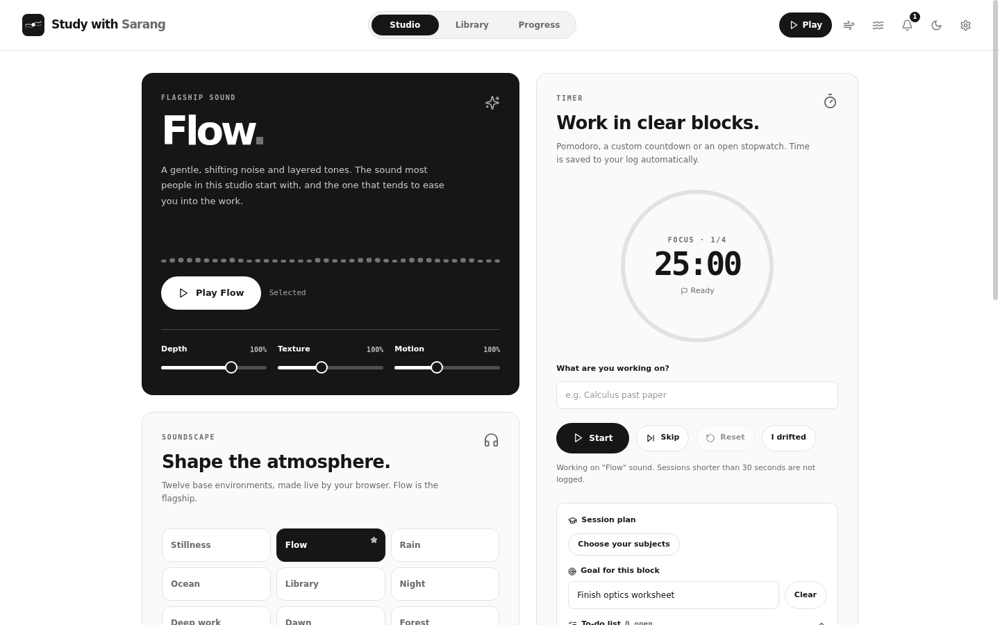
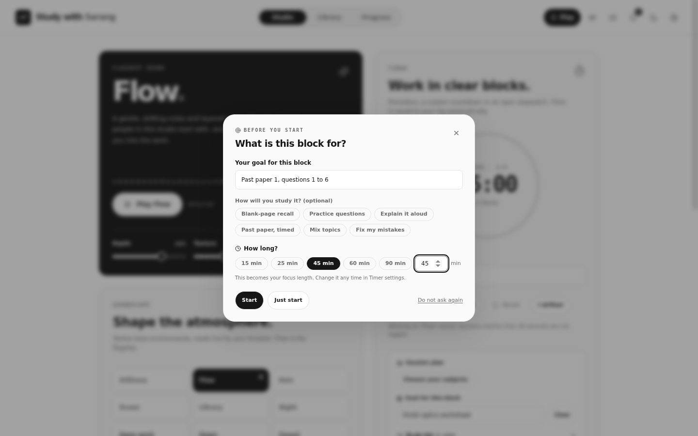
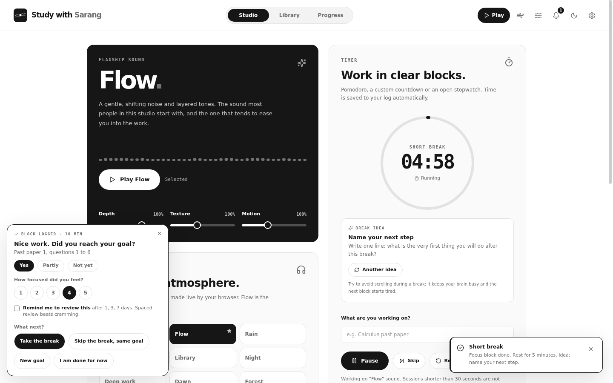
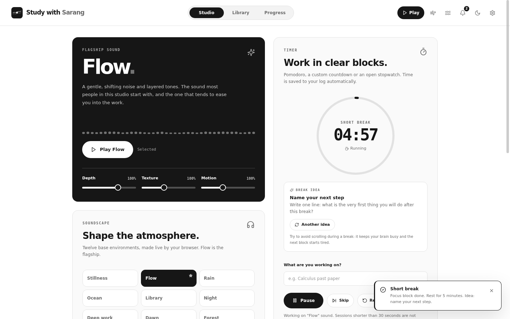
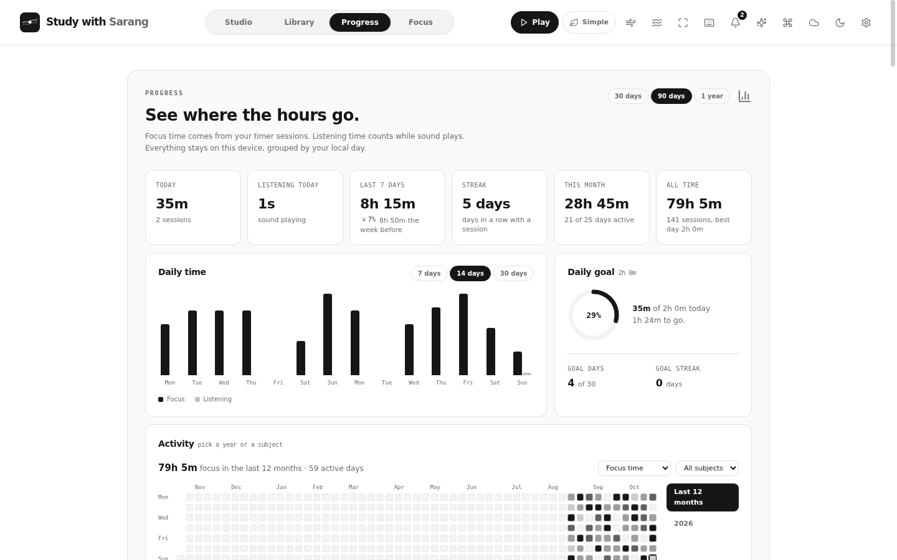

# Study with Sarang

A calm focus studio for students. Live ambient sound, a goal-first timer, mindful breaks, honest progress and, on Windows, a desktop app with real notifications, media keys and voice commands. Free, offline, no account, no tracking.

**[Open in your browser](https://sarang-md.vercel.app/study-with-sarang/) · [Downloads](https://sarang-md.vercel.app/study-with-sarang/downloads/) · [Deployment guide](docs/DEPLOYMENT_GUIDE.md) · [Accounts and emails](docs/EMAIL_AND_ACCOUNTS.md)**



## Download

| Edition | Where |
| --- | --- |
| **Windows 10/11 (64-bit)** | [Downloads page](https://sarang-md.vercel.app/study-with-sarang/downloads/): `Study-with-Sarang-<version>.exe` (one file, animated installer, no admin rights, checksums on the page). Direct link that never changes: [`Study-with-Sarang-Windows.exe`](https://study-with-sarang.vercel.app/downloads/Study-with-Sarang-Windows.exe). |
| **Browser** | [sarang-md.vercel.app/study-with-sarang/](https://sarang-md.vercel.app/study-with-sarang/) |
| **Browser helper** | [Study with Sarang Helper](https://sarang-md.vercel.app/study-with-sarang/downloads/) (Chrome, Edge, Brave): tells the desktop app which website is open, for drift detection. Pairs with one click. |
| macOS, Linux, Android | Not available yet. macOS builds are possible from the same code but untested. |

The Windows exe is signed with a self-made certificate, so SmartScreen asks once (More info, then Run anyway). Compare the SHA-256 on the downloads page with `Get-FileHash .\Study-with-Sarang-*.exe`.

## What it does

- **Essentials by default.** Three pages, one timer, a few icons. Settings, Advanced, **Show everything** brings back every feature.
- **A rhythm for each session.** Start asks for a goal and minutes. The wrap-up asks if you reached it, how focused you felt and what next. Reviews are scheduled at 1, 3 and 7 days.
- **Mindful breaks.** One gentle idea at a time: look far away, stretch, water, breathing. No scrolling.
- **Sound made on your device.** 12 environments and 26 layers, generated live. No recordings, no brainwave claims.
- **Honest progress.** Weekly summary, year heatmap, streaks, goals and 91 achievements, stored on your device.
- **Flow, the voice assistant (desktop).** "Flow, pause my music." Hold a key and speak. Voice engines: system, OpenAI, Groq Orpheus, Gemini.
- **Subjects and exams.** IB, GCSE, IGCSE, CBSE, A Level, AP or your own, with an exam countdown.
- **Desktop extras.** Real notifications, a mini bar that stays on top, media keys that follow the last player, tray, optional Discord presence, updates from the website with SHA-256 checks.
- **Private.** Optional cloud sync uses your own Supabase project; API keys never leave the device.

| | |
| --- | --- |
|  |  |
|  |  |

## Repository layout

| Folder | What is in it |
| --- | --- |
| `desktop/` | The Windows app: Vite, React, TypeScript, Tailwind, Electron. `MASTER_GUIDE.md` is the long guide, `CHANGELOG.md` lists every change. |
| `web/` | The browser edition of the same source (no Electron parts). Version numbers differ: desktop 2.1.1 goes with web 1.9.1. |
| `landing/assets/` | The screenshots used by every README. (The old landing page is archived in `docs/archive/`; the download page replaced it.) |
| `docs/` | `PLAN.md` (the plan for each request), `DEPLOYMENT_GUIDE.md`, `SUITE.md` (how the Sarang apps fit together). |
| `site/` | The generator for the two Vercel sites: download pages, update feeds, checksums and routes (`build.mjs`, `test-site.mjs`). |
| `.github/workflows/` | `ci.yml` (tests only). Nothing is hosted or released from GitHub. |

## Build it yourself

Requires Node.js 20+.

```bash
# the browser edition
cd web && npm ci && npm run dev

# the Windows app (develop)
cd desktop && npm ci && npm run build && npx electron .

# tests
cd desktop && npm test          # fast checks
cd desktop && npm run test:ui   # full UI tests, needs a display (on Linux: xvfb-run)

# a release build (on Windows, or Linux with Wine-free electron-builder as used here)
cd desktop && npm run build && npx electron-builder --win --x64
```

`docs/DEPLOYMENT_GUIDE.md` covers publishing the landing page, the web app and a release.

## Part of the Sarang suite

[Sarang.md](https://sarang-md.vercel.app/) is the sibling app: an IB Mathematics AA course with lessons, an IB-style question bank and mark schemes. Same design, same settings layout, same desktop shell. See [docs/SUITE.md](docs/SUITE.md).

## Honest limits

Windows toasts, other-app media control, Windows speech recognition and live Groq or Gemini voices cannot be tested outside Windows and a real key; they are built and unit-tested, but report anything odd as an issue. Study with Sarang is independent and not affiliated with the IB.
