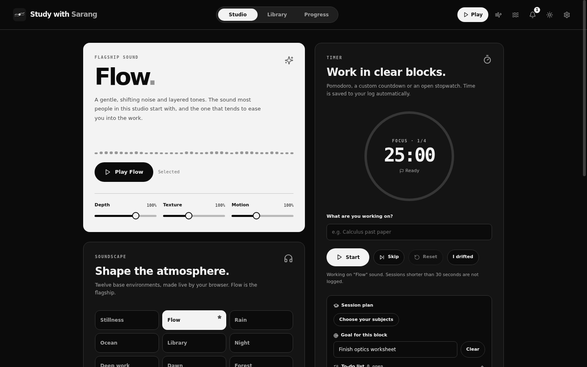
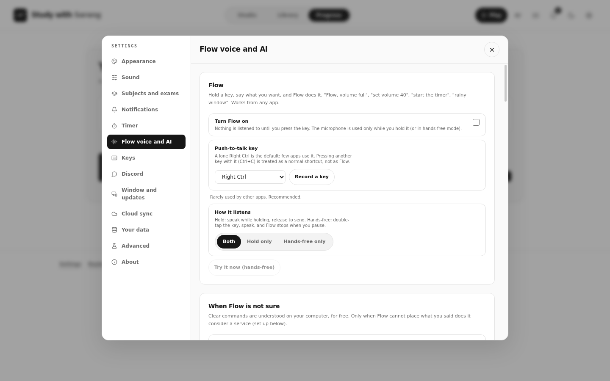
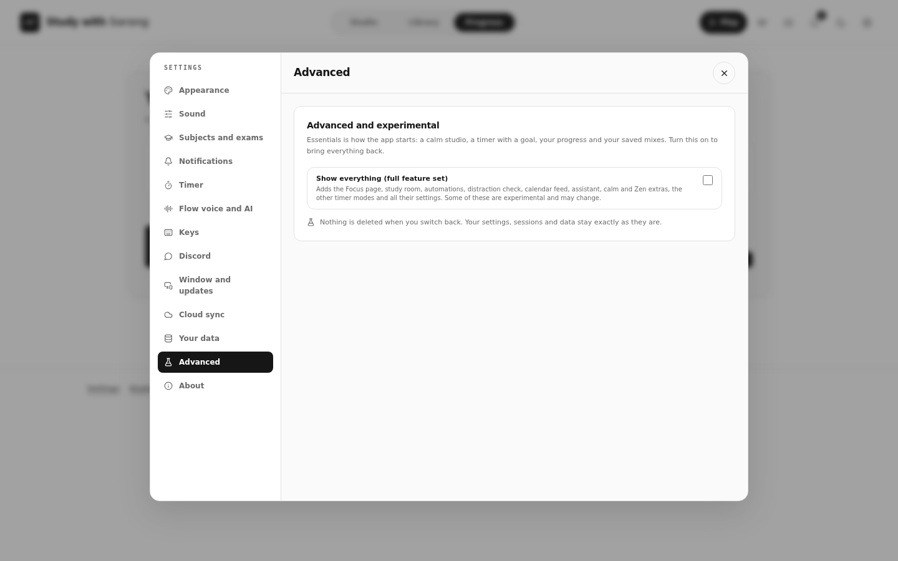

# Study with Sarang 1.9.1 edition 1.9.0

A focus studio for students: live ambient sound, a focus timer with goals and to-dos, subject-aware statistics and an exam countdown, achievements, a calm corner, and (in the desktop app) a floating timer that follows you across your desktop, drift detection, calendar sync and an AI assistant that can set the app up for you.

It is for **IB Diploma** students (DP1 or DP2, May or November session) and equally for **GCSE, IGCSE, CBSE, A Level, AP** or anything else: choose a programme or type your own subjects. It is a separate product from Sarang.MD that shares only its look.

**New here? Read `MASTER_GUIDE.md`.** It is the one long guide: install, every feature, every optional service, build, publish and troubleshoot. `CHANGELOG.md` lists everything that changed since the first version.

**Download:** get the newest build from the [GitHub releases](https://github.com/sarang-cmd/study-with-sarang/releases/latest) or from the [landing page](https://sarang-cmd.github.io/study-with-sarang/). Source: [github.com/sarang-cmd/study-with-sarang](https://github.com/sarang-cmd/study-with-sarang). Part of the Sarang suite with [Sarang.md](https://github.com/sarang-cmd/sarang.md).

## Screenshots

| | |
| --- | --- |
|  |  |
| **Studio (Essentials).** Flow sound on the left, the timer on the right. | **Before you start.** A goal, a method and a length. |
|  |  |
| **After a block.** Goal reached? How focused? What next? | **Breaks.** One calm idea at a time. |
|  |  |
| **Progress** (Settings, Advanced, Show everything). | **Dark mode.** |
|  |  |
| **Flow voice and AI.** Pick the voice engine. | **Advanced.** One switch brings everything back. |

## Use it (web edition)

Run `npm ci && npm run build` and upload `dist/` to any static host with HTTPS. Desktop-only features (puck over other apps, monitors and snap, drift watcher, auto-pause, Discord, global shortcuts, installer and updater) are hidden or explained in the web edition.

## What you get

| Need | How it works |
| --- | --- |
| **Sound** | 12 base environments with Flow as the flagship, 26 layers, fine-tuning, saved mixes, real recordings, sleep timer. |
| **Timer, goals and to-dos** | Pomodoro, countdown or stopwatch. A goal for each block, a to-do list, subject for each session. |
| **Subjects and exams** | IB, GCSE, IGCSE, CBSE, A Level, AP or your own. Exam session, countdown, weekly minutes per subject. |
| **Statistics** | Per-subject numbers, filters, a yearly heatmap with a year selector, records and streaks. |
| **91 achievements** | Not too easy, four tiers, secret ones, unlock cards and a notification bell. |
| **Zen and the study room** | A full-screen clock, with your own study-with-me style video instead of sound if you like. |
| **Focus page** | Ethos, logos and pathos: honest reasons to start, your own reason, a daily Socratic question, the optional neural lock. |
| **Mini player** | A small timer and sound player that appears when you scroll; the desktop puck stays over every app. |
| **Automations** | When a block ends, a goal is missed, drift is detected or it is a certain time: do something. |
| **Drift detection** (desktop) | Lists of apps and websites like parental controls, an optional browser extension, an optional AI check. |
| **Monitors and snap** (desktop) | Real monitor names, keep the app on one screen, move when a screen connects, 12 snap layouts. |
| **Calendar** | Your sessions in Google Calendar through a private link. |
| **AI, your own key** | Free options for every integration, a setup walkthrough, and an assistant with 21 tools. Free dictation: 5 a day. |
| **Flow voice** | Hold Right Ctrl and talk (desktop only). Replies can use a system, Groq, Gemini or OpenAI voice. |
| **Calm by default** | Starts in Essentials (Studio, Library, Progress, a short top bar). Settings, Advanced brings back every feature. |
| **Session rhythm** | A question for goal and minutes before a block, a wrap-up after it (goal met, focus rating, reviews at 1, 3 and 7 days, what next) and one mindful idea for every break. |
| **Flow commands** | "Flow, pause my music", "study for 45 minutes", "add a to-do", "how long did I study today" and many more (other apps and system volume need the desktop app). |
| **Customise everything** | Every integration is off until you turn it on. |

## Commands

```bash
npm ci
npm run build          # type check and build
npm test               # unit tests
```

## Documents

- `MASTER_GUIDE.md`: everything, in one place.
- `CHANGELOG.md` and `VERSION_HISTORY.md`: every version.
- `docs/`: the appendices of the master guide as separate files.
- `supabase/`: SQL and functions for sync, the calendar link and free dictation.

## Privacy

Everything stays on your computer unless you switch on a service: sync, the calendar link, or an AI feature (then the text or audio for that request goes to the provider whose key you pasted). Keys are never synced or shown to the assistant.

## Honest limits

Written and tested in a Linux build environment with simulated Windows parts. Please check on your PC: the exe and SmartScreen, icon changes in the Start menu and taskbar, the puck over other apps, snap and monitor changes on real displays, the foreground-window watcher and the browser extension, the calendar feed and Flow Cloud on a deployed Supabase project, real provider keys and models, and the neural-lock rhythm. The full list is in chapter 14 of the master guide. macOS and the Microsoft Store package could not be built here. Android is not part of this version.
